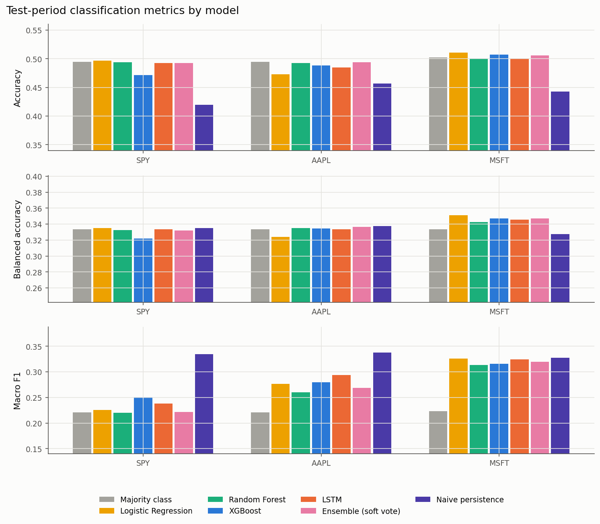
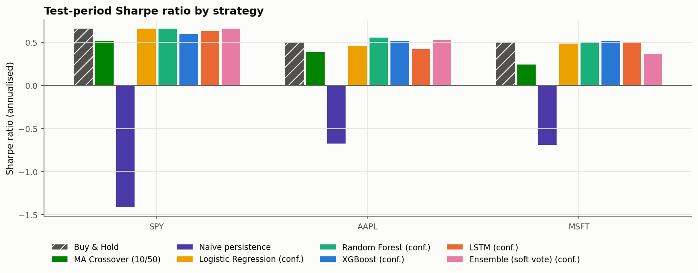
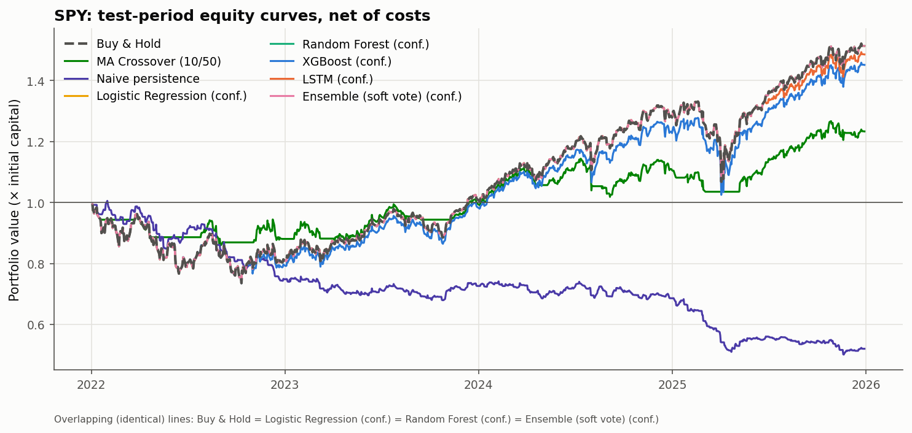
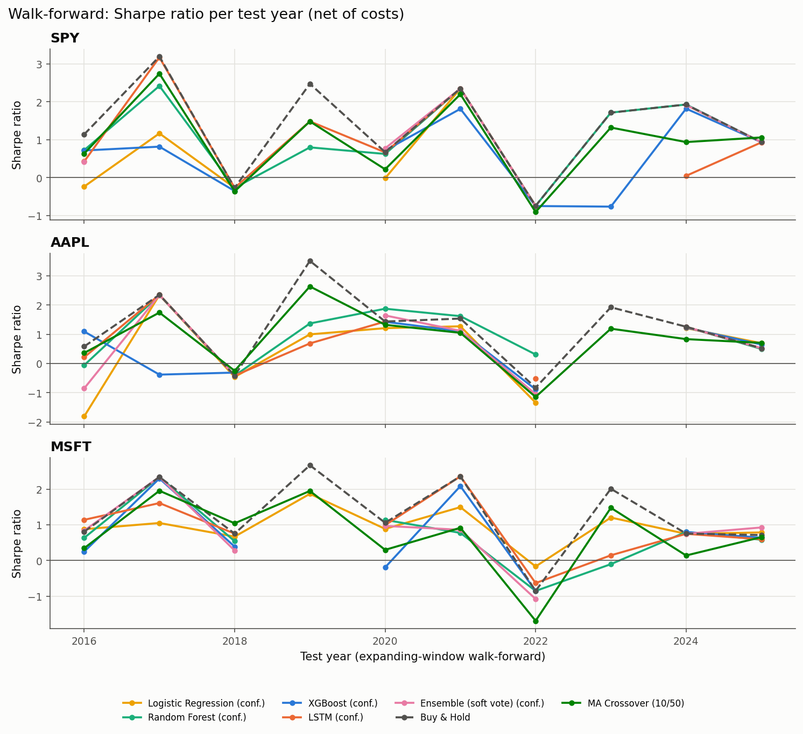
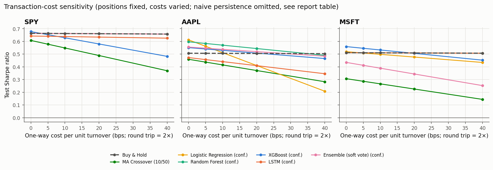

# Machine Learning Based Algorithmic Trading Signals

### A Comparative Study Against Technical Baseline Strategies

Mini-project, B.Tech. Computer Science & Engineering (AI & ML), V Semester. School of Computer Engineering,
**Manipal Institute of Technology**, Manipal Academy of Higher Education, 2026.

**Authors:** Ishan Singh, Kenneth Martin. **Mentors:** Dr. Narendra V G, Dr. Ashwath Rao B.

> **Disclaimer.** This is academic research software. Backtests are hypothetical, rest on simplifying
> assumptions and do not guarantee future results. Nothing here is investment advice.

---

## Abstract

Rule-based technical strategies such as moving-average crossovers are cheap and interpretable, but static. This
project builds a reproducible framework that asks whether **supervised machine learning** can turn the same
market information into better trading signals. Daily OHLCV data for SPY, AAPL and MSFT (Yahoo Finance,
2010–2025) is converted into 42 point-in-time features: returns, SMA/EMA, RSI, MACD, Bollinger Bands, ATR,
volatility, volume and regime indicators. Five ML models predict the direction of the next tradable period as
Down / Neutral / Up: **Logistic Regression, Random Forest, XGBoost, an LSTM sequence model and a soft-voting
ensemble**. Hyperparameters are tuned with purged time-series cross-validation. Predicted probabilities become
long/flat positions through a confidence threshold chosen on a separate validation period. Every strategy,
together with **buy-and-hold, a 10/50 moving-average crossover and naive persistence**, runs through one cost-aware
backtester with next-open execution, 15 bps one-way per unit of turnover (30 bps per round trip), and identical dates and capital. Evaluation covers
classification quality (accuracy, macro precision/recall/F1, log loss, Brier, calibration) and trading quality
(cumulative and annualised return, volatility, Sharpe, Sortino, maximum drawdown, win rate, turnover). Robustness is
checked with a 10-year expanding-window walk-forward, regime and per-year breakdowns, transaction-cost and threshold
sensitivity, execution-timing and target-definition variants, feature ablation, and block-bootstrap confidence intervals.

## Problem statement

For each trading day *t*, using only information available at the close of *t*, predict the direction of the next
tradable return. Turn the prediction into a position, and measure, after costs, whether ML signals beat technical
baselines on predictive and risk-adjusted metrics.

## Motivation and objectives

1. Implement buy-and-hold and moving-average-crossover baselines in a consistent, cost-aware backtester.
2. Engineer technical indicators (SMA, EMA, RSI, MACD, Bollinger Bands, …) as features for ML models,
   including XGBoost and an LSTM.
3. Compare ML signals with the baselines using predictive **and** risk-adjusted trading metrics across assets
   and market conditions.
4. (Stretch, synopsis section 5.8) News-sentiment RAG features. **Not implemented**; see
   [docs/limitations.md](docs/limitations.md).

## What makes this a genuine ML project

| Rule-based strategy | Supervised ML classifiers | Sequence model (LSTM) |
|---|---|---|
| Hand-written rule (`SMA10 > SMA50`), no learning, no parameters fitted to data | Learn a mapping *features → P(Down, Neutral, Up)* from ~2,200 labelled days; capacity is controlled by tuned hyperparameters | Learns from **windows** of the last 10–20 days of features, so it can model temporal dependencies that a single-day feature vector cannot represent |

ML components implemented:

* **Supervised multiclass classification** with an explicit, execution-aligned target and a configurable neutral band.
* **Four learners + ensemble:** L2-regularised multinomial Logistic Regression (scaled in a `Pipeline`), Random Forest,
  XGBoost (gradient-boosted trees) and a PyTorch LSTM, plus a soft-voting ensemble whose members are chosen on
  validation data.
* **Hyperparameter tuning** by exhaustive grid search with **purged `TimeSeriesSplit`** cross-validation, scored by
  log loss. Class weighting is tuned as a hyperparameter. The LSTM architecture and class weighting are tuned, with
  early stopping, on a purged slice at the end of the training period, so the validation period stays out-of-sample.
* **Probability-based decisions:** confidence thresholds on P(Up) selected on validation, compared with argmax trading.
* **Validation protocols:** a single chronological holdout **and** a 10-fold expanding-window **walk-forward** with
  per-fold re-tuning.
* **Interpretability:** permutation importance (validation), impurity/gain importance, mutual information,
  feature-group ablation, confusion matrices, reliability diagrams and ECE.
* **Uncertainty:** circular block-bootstrap confidence intervals for Sharpe ratios and accuracy differences.
* **Leakage prevention**, verified by tests: point-in-time features (truncation invariance), purging, train-only
  scaling, and a single use of the test set.

## System architecture

```
 Yahoo Finance ──► data_loader ──► features (42, point-in-time) ──► targets (execution-aligned labels)
  (cached, SHA-256)  validate/adjust            │                              │
                                                 └──────────┬───────────────────┘
                                                 preprocessing: purged chronological split
                                                            │
             ┌──────────────────────────────────────────────┼──────────────────────────────────┐
     models.py (LR / RF / XGB, purged CV)        lstm_model.py (windows, early stop)     baselines.py
             └──────────────────────── ensemble (val log loss) ─────────────────────────────────┘
                                                            │  P(Down, Neutral, Up)
                         signals: threshold τ chosen on validation → positions
                                                            │
                     backtester.py (next-open fills, fees + slippage, equity, drawdown)
                                                            │
       evaluation.py (classification, calibration, bootstrap)   walk-forward / robustness   visualization.py
                                                            │
                                 reporting.py → results/reports/experiment_report.md
```

## Repository structure

```
ML_Based_Algorithmic_Trading/
├── config.yaml                  # every experimental setting
├── requirements.txt             # core dependencies (+ requirements-notebooks.txt)
├── src/
│   ├── data_loader.py           # yfinance download, cache, validation, adjustment, synthetic fallback
│   ├── features.py              # SMA/EMA/RSI/MACD/Bollinger/ATR + 42 model features
│   ├── targets.py               # execution-aligned forward returns and labels
│   ├── preprocessing.py         # dataset assembly, purged splits, walk-forward folds, LSTM windows
│   ├── baselines.py             # buy & hold, MA crossover, persistence, majority class
│   ├── models.py                # LR / RF / XGBoost, purged time-series grid search
│   ├── lstm_model.py            # PyTorch LSTM classifier
│   ├── backtester.py            # cost-aware backtester, trading metrics, signal rules
│   ├── evaluation.py            # classification metrics, calibration, bootstrap, importance
│   ├── experiment.py            # orchestration: train / evaluate / walk-forward / sensitivity
│   ├── reporting.py             # Markdown report + README results block from saved metrics
│   ├── visualization.py         # figures
│   └── utils.py
├── app/                         # Streamlit dashboard (live demo) + its lightweight requirements.txt
├── scripts/                     # CLI entry points (download_data, train, evaluate, run_experiment, generate_report)
├── tests/                       # pytest suite (leakage, features, targets, backtester, models, pipeline)
├── notebooks/                   # 01 EDA, 02 features, 03 model evaluation (read saved results)
├── docs/                        # methodology, model comparison, limitations, submission checklist
├── data/README.md               # data provenance (raw CSVs are downloaded, not committed)
└── results/
    ├── metrics/                 # CSV/JSON: metrics, tuning tables, thresholds, bootstrap, walk-forward
    ├── figures/                 # PNG figures
    ├── predictions/             # out-of-sample probabilities, positions and equity curves
    └── reports/experiment_report.md
```

## Data

| Item | Value |
|---|---|
| Source | Yahoo Finance via `yfinance` (free, no API key) |
| Instruments | SPY (S&P 500 ETF), AAPL, MSFT |
| Period downloaded | 2010-01-01 → 2025-12-31, daily |
| After indicator warm-up | first usable decision day 2011-01-31 (252-day windows) |
| Train / Validation / Test | 2011-01 → 2019-12 / 2020-01 → 2021-12 / 2022-01 → 2025-12 |
| Adjustment | split + dividend adjusted (`Adj Close / Close` factor applied to OHLC) |

The exact rows, date range and SHA-256 checksum of each input file are in `results/metrics/data_manifest.json`.
Details: [data/README.md](data/README.md).

## Method in brief

* **Target:** decision after the close of *t*, fill at the open of *t+1*, exit at the open of *t+2*.
  `r_t = Open[t+2]/Open[t+1] − 1`, label Down (`r < −0.1%`), Neutral (`|r| ≤ 0.1%`) or Up (`r > 0.1%`).
  The market-on-close definition `Close[t+1]/Close[t] − 1` and a binary target are reported as sensitivity variants.
* **Features:** 42 scale-invariant features in five groups (returns, technical, volatility, volume, regime).
* **Training / validation:** purged chronological split; purged `TimeSeriesSplit` CV on train; validation for the
  LSTM architecture, ensemble members and thresholds; test used once.
* **Signals:** long if P(Up) ≥ τ (τ from validation Sharpe), else cash. Argmax variants are also reported.
* **Backtest:** next-open execution, 10 bps fee + 5 bps slippage per unit turnover, start in cash, 100,000 initial capital.

Full specification: **[docs/methodology.md](docs/methodology.md)**. Model roles and discussion:
**[docs/model_comparison.md](docs/model_comparison.md)**.

## Results

<!-- RESULTS:START -->
All numbers below are generated from `results/metrics/` by `python -m scripts.generate_report` (real Yahoo Finance data; test period **2022-01-03 → 2025-12-29**, 1001 trading days per ticker; next-open execution; 15 bps per unit turnover; long-only). Full tables: [results/reports/experiment_report.md](results/reports/experiment_report.md).

ML rows use the confidence rule (long if P(Up) ≥ τ, τ chosen on validation). Classification metrics are test-set accuracy and **macro**-averaged precision / recall / F1 over Down, Neutral, Up. N/A = not applicable (rule-based strategy, no class predictions).

#### SPY

| Strategy | Accuracy | Precision | Recall | F1 | Cum. return | Sharpe | Sortino | Max DD | Turnover/yr | Trades |
|---|---|---|---|---|---|---|---|---|---|---|
| Buy & Hold | N/A | N/A | N/A | N/A | 51.36% | 0.66 | 0.94 | -26.40% | 0.3 | 1 |
| MA Crossover (10/50) | N/A | N/A | N/A | N/A | 23.35% | 0.52 | 0.72 | -14.00% | 6.8 | 27 |
| Naive persistence | 0.420 | 0.335 | 0.335 | 0.335 | -47.92% | -1.42 | -1.79 | -50.12% | 123.9 | 492 |
| Majority class (classifier only) | 0.495 | 0.165 | 0.333 | 0.221 | N/A | N/A | N/A | N/A | N/A | N/A |
| Logistic Regression (conf.) | 0.497 | 0.415 | 0.335 | 0.226 | 51.36% | 0.66 | 0.94 | -26.40% | 0.3 | 1 |
| Random Forest (conf.) | 0.494 | 0.165 | 0.333 | 0.220 | 51.36% | 0.66 | 0.94 | -26.40% | 0.3 | 1 |
| XGBoost (conf.) | 0.472 | 0.275 | 0.322 | 0.250 | 45.16% | 0.60 | 0.86 | -26.47% | 8.8 | 35 |
| LSTM (conf.) | 0.493 | 0.314 | 0.334 | 0.238 | 48.59% | 0.64 | 0.91 | -26.40% | 0.8 | 3 |
| Ensemble (soft vote) (conf.) | 0.493 | 0.248 | 0.332 | 0.221 | 51.36% | 0.66 | 0.94 | -26.40% | 0.3 | 1 |

#### AAPL

| Strategy | Accuracy | Precision | Recall | F1 | Cum. return | Sharpe | Sortino | Max DD | Turnover/yr | Trades |
|---|---|---|---|---|---|---|---|---|---|---|
| Buy & Hold | N/A | N/A | N/A | N/A | 52.42% | 0.51 | 0.73 | -33.33% | 0.3 | 1 |
| MA Crossover (10/50) | N/A | N/A | N/A | N/A | 24.02% | 0.39 | 0.56 | -25.39% | 7.8 | 31 |
| Naive persistence | 0.457 | 0.337 | 0.338 | 0.337 | -43.31% | -0.68 | -0.89 | -55.08% | 122.1 | 485 |
| Majority class (classifier only) | 0.495 | 0.165 | 0.333 | 0.221 | N/A | N/A | N/A | N/A | N/A | N/A |
| Logistic Regression (conf.) | 0.473 | 0.298 | 0.324 | 0.276 | 43.22% | 0.46 | 0.67 | -35.20% | 28.4 | 113 |
| Random Forest (conf.) | 0.493 | 0.322 | 0.335 | 0.260 | 61.28% | 0.56 | 0.81 | -34.80% | 7.8 | 31 |
| XGBoost (conf.) | 0.489 | 0.315 | 0.334 | 0.280 | 54.54% | 0.52 | 0.75 | -33.46% | 6.3 | 25 |
| LSTM (conf.) | 0.485 | 0.316 | 0.334 | 0.294 | 38.46% | 0.43 | 0.61 | -35.71% | 9.3 | 37 |
| Ensemble (soft vote) (conf.) | 0.494 | 0.323 | 0.336 | 0.269 | 56.29% | 0.53 | 0.77 | -33.33% | 5.3 | 21 |

#### MSFT

| Strategy | Accuracy | Precision | Recall | F1 | Cum. return | Sharpe | Sortino | Max DD | Turnover/yr | Trades |
|---|---|---|---|---|---|---|---|---|---|---|
| Buy & Hold | N/A | N/A | N/A | N/A | 50.35% | 0.51 | 0.75 | -34.70% | 0.3 | 1 |
| MA Crossover (10/50) | N/A | N/A | N/A | N/A | 11.63% | 0.25 | 0.36 | -27.85% | 7.0 | 28 |
| Naive persistence | 0.443 | 0.327 | 0.327 | 0.327 | -45.57% | -0.69 | -0.98 | -51.61% | 125.4 | 498 |
| Majority class (classifier only) | 0.502 | 0.167 | 0.333 | 0.223 | N/A | N/A | N/A | N/A | N/A | N/A |
| Logistic Regression (conf.) | 0.510 | 0.335 | 0.351 | 0.326 | 46.65% | 0.49 | 0.72 | -34.63% | 5.8 | 23 |
| Random Forest (conf.) | 0.500 | 0.325 | 0.343 | 0.313 | 50.35% | 0.51 | 0.75 | -34.70% | 0.3 | 1 |
| XGBoost (conf.) | 0.507 | 0.330 | 0.347 | 0.316 | 51.85% | 0.52 | 0.76 | -34.70% | 7.3 | 29 |
| LSTM (conf.) | 0.500 | 0.326 | 0.345 | 0.324 | 50.35% | 0.51 | 0.75 | -34.70% | 0.3 | 1 |
| Ensemble (soft vote) (conf.) | 0.505 | 0.329 | 0.347 | 0.320 | 28.35% | 0.37 | 0.54 | -36.12% | 12.3 | 49 |

#### Walk-forward, out-of-sample 2016–2025 (annual retraining)

| Strategy | SPY Sharpe | SPY cum. return | AAPL Sharpe | AAPL cum. return | MSFT Sharpe | MSFT cum. return |
|---|---|---|---|---|---|---|
| Buy & Hold | 0.90 | 301.95% | 0.98 | 1043.51% | 1.03 | 912.76% |
| MA Crossover (10/50) | 0.74 | 118.26% | 0.87 | 400.26% | 0.70 | 217.58% |
| Logistic Regression (conf.) | 0.34 | 50.34% | 0.50 | 149.47% | 0.76 | 272.87% |
| Random Forest (conf.) | 0.70 | 183.47% | 0.89 | 580.47% | 0.57 | 183.27% |
| XGBoost (conf.) | 0.41 | 70.02% | 0.42 | 105.68% | 0.42 | 99.19% |
| LSTM (conf.) | 0.51 | 97.45% | 0.50 | 160.53% | 0.69 | 274.32% |
| Ensemble (soft vote) (conf.) | 0.46 | 84.14% | 0.56 | 202.78% | 0.52 | 151.10% |

#### Key findings (computed by fixed rules from the tables)

- **SPY** - highest test macro-F1: XGBoost (0.250); highest test accuracy: Logistic Regression (0.497) vs majority-class accuracy 0.495 (macro-F1 0.221).
- **AAPL** - highest test macro-F1: LSTM (0.294); highest test accuracy: Ensemble (soft vote) (0.494) vs majority-class accuracy 0.495 (macro-F1 0.221).
- **MSFT** - highest test macro-F1: Logistic Regression (0.326); highest test accuracy: Logistic Regression (0.510) vs majority-class accuracy 0.502 (macro-F1 0.223).
- Test period, 15 ML confidence-threshold strategies (models x tickers) vs buy-and-hold: Sharpe ratio higher for 4, lower for 6; cumulative return higher for 4, lower for 6; maximum drawdown smaller for 1, larger for 6 (the remainder are equal within 1e-09).
- 5 of 15 ML strategies were invested on every test day and are therefore identical to buy-and-hold (Logistic Regression on SPY, Random Forest on SPY, Ensemble (soft vote) on SPY, Random Forest on MSFT, LSTM on MSFT): the threshold selected on the validation period kept them always long.
- The MA-crossover baseline had a higher test Sharpe ratio than buy-and-hold for 0 of 3 tickers.
- Block-bootstrap 95% intervals for Sharpe(strategy) - Sharpe(buy-and-hold) - ML strategies: 0 of 15 entirely above 0, 1 entirely below 0, 9 include 0, 5 identical to buy-and-hold (zero difference); rule-based baselines: 0 of 6 entirely above 0, 3 entirely below 0, 3 include 0. An interval that includes 0 means no reliable difference at this sample size.
- Accuracy minus majority-class accuracy (block bootstrap): 0 of 15 model/ticker intervals lie entirely above 0, 1 entirely below 0, the rest include 0.
- Walk-forward (2016-2025, annual retraining): 0 of 15 ML strategies had a higher out-of-sample Sharpe ratio than buy-and-hold (15 lower); 0 had a higher cumulative return.

#### Selected figures

**Test-period classification metrics**



**Test-period Sharpe ratio by strategy**



**SPY equity curves (test, net of costs)**



**Walk-forward Sharpe ratio per year**



**Transaction-cost sensitivity**



<!-- RESULTS:END -->

## Installation

Python 3.10+ (tested with 3.12 and 3.14 on Windows).

```bash
python -m venv .venv
```

```bash
# Windows: .venv\Scripts\activate    macOS/Linux: source .venv/bin/activate
pip install -r requirements.txt
```

For a CPU-only PyTorch wheel (smaller download), add `--extra-index-url https://download.pytorch.org/whl/cpu`.
Without PyTorch, run with `--skip-lstm`. If XGBoost cannot be installed, the code switches to scikit-learn's
`HistGradientBoostingClassifier` and labels it as such everywhere.

## How to run

All commands are run from the project root.

```bash
python -m scripts.run_experiment
```

Runs the full experiment: download/cache data, train and tune all models, backtest, walk-forward, robustness,
figures, and the report and README results. It takes roughly 20–30 minutes on a laptop CPU and writes to `results/`.

```bash
python -m scripts.run_experiment --quick
```

Smoke run in about 3 minutes: SPY only, no LSTM tuning, short walk-forward. Writes to `results_quick/`.

Other entry points:

| Command | Purpose |
|---|---|
| `python -m scripts.download_data [--refresh]` | download / verify the data and write the manifest |
| `python -m scripts.train` | stage 1: tune and fit the models, save validation/test predictions |
| `python -m scripts.evaluate` | stage 2: metrics, thresholds, backtests, robustness, figures (needs stage 1) |
| `python -m scripts.generate_report` | rebuild the Markdown report and README results from saved metrics |
| `python -m scripts.run_experiment --tickers AAPL` | single-asset run with the full settings |
| `python -m scripts.run_experiment --skip-walk-forward --skip-lstm` | faster run without the slow stages |
| `python -m scripts.run_experiment --synthetic --quick` | offline development run on **synthetic** data (labelled as such) |

### Interactive dashboard (live demo)

`app/streamlit_app.py` is a Streamlit dashboard over the project. Every number in it is computed by the code in `src/`:

| Tab | What it shows |
|---|---|
| Overview | headline test results, rule-based key findings, model comparison table |
| Interactive backtest | re-runs `src/backtester.py` live on the saved out-of-sample probabilities; change model, threshold τ, costs, long/short and volatility sizing |
| Predictions | classification metrics, confusion matrix, calibration curve and the latest predictions, computed from the saved predictions |
| Walk-forward & robustness | 2016–2025 walk-forward equity recomputed live, yearly Sharpe, bootstrap intervals, cost sensitivity |
| Train a model live | downloads fresh Yahoo Finance data and runs the full pipeline (features → purged split → train → τ on validation → backtest) in seconds |
| Figures & docs | all generated figures and the methodology / comparison / limitations documents |

Run it locally:

```bash
pip install -r app/requirements.txt
```

```bash
streamlit run app/streamlit_app.py
```

**Hosting on Streamlit Community Cloud (free).** At [share.streamlit.io](https://share.streamlit.io), sign in with GitHub
and choose **Create app → Yup, I have an app**. Enter repository `KennethMartin06/ml-based-algorithmic-trading-signals`,
branch `main` and main file path `app/streamlit_app.py`, then deploy. Community Cloud installs `app/requirements.txt`,
which omits PyTorch (the dashboard reads the saved LSTM predictions). The app redeploys automatically on every push.
An app from a private repository is private by default. Invite viewers by email with **Share**, or switch the app (not
the code) to public in its sharing settings.

### Mini-project report (IEEE conference format)

The report is generated from the official IEEE conference template (A4) and the saved results. Every number in
its text and tables is read from `results/metrics`, references are numbered in order of first citation, and the
build fails if a listed reference is never cited.

```bash
python report/report_figures.py
```

```bash
python report/build_report.py --pdf
```

The output goes to `report/output/` (`.docx`, plus a `.pdf` rendered by Microsoft Word on Windows). The generated
report is git-ignored because it contains the authors' registration numbers.

Notebooks (optional, `pip install -r requirements-notebooks.txt`): `notebooks/01_exploratory_data_analysis.ipynb`,
`02_feature_engineering.ipynb` and `03_model_evaluation.ipynb` read the saved results. No training happens in the notebooks.

## Tests

```bash
python -m pytest -q
```

The suite uses deterministic synthetic fixtures, makes no network calls, and covers: data validation and caching,
indicator values against hand calculations, target construction and label alignment, chronological splitting and
purging, **truncation-invariance (no look-ahead) of features and baselines**, train-only scaling, LSTM window
alignment, backtester accounting (costs, equity, drawdown, signal timing, NaN handling), metric formulas, model
fitting and tuning, and an end-to-end pipeline smoke test.

## Configuration

Everything is in `config.yaml`: universe and dates, target scheme / horizon / neutral band, execution convention
(`next_open` or `close`), split dates, feature windows, model grids, LSTM settings, signal mode (`long_only` /
`long_short`), threshold grid, costs, walk-forward years and robustness options. Example: to test a 2-day horizon
with a 0.2% neutral band, set `target.horizon: 2` and `target.neutral_threshold: 0.002`.

## Reproducibility

* Fixed seeds (`experiment.seed = 42`) for NumPy, scikit-learn, XGBoost and PyTorch, plus a seeded data loader for the LSTM.
* Library versions and runtimes are stored in `results/metrics/run_summary.json`.
* Input data is fingerprinted in `results/metrics/data_manifest.json`.
* All tables and figures, the report and this README's results block are generated by code from saved metrics.
  No number is typed in by hand.

## Limitations and future work

Main limitations: weak daily signal, one test period, three hindsight-selected large caps, flat cost model, and no
market impact. See **[docs/limitations.md](docs/limitations.md)**. Future work: a leakage-safe news-sentiment (RAG)
extension, a broader and survivorship-free universe, longer horizons, probability calibration, deflated Sharpe
ratios for multiple testing, and portfolio-level allocation across assets.

## References

The literature list is in the project synopsis. Main sources of methods used here:

1. Y. Huang et al., "A novel deep reinforcement learning framework with BiLSTM-Attention networks for algorithmic trading," *Expert Systems with Applications*, 240, 122581, 2024.
2. N. Sukma and C. S. Namahoot, "An Algorithmic Trading Approach Merging Machine Learning With Multi-Indicator Strategies for Optimal Performance," *IEEE Access*, 12, 2024.
3. J. Tang, "Stock movement prediction: A multi-input LSTM approach," *Journal of Forecasting*, 43(5), 2024.
4. J. Yang, Y. Wang and X. Li, "Prediction of stock price direction using the LASSO-LSTM model combines technical indicators and financial sentiment analysis," *PeerJ Computer Science*, 2022.
5. G. Maji and S. Sen, "Sectoral recommendation system for medium term investment using technical indicators," *Expert Systems with Applications*, 258, 2024.
6. L. Bacco et al., "Investigating Stock Prediction Using LSTM Networks and Sentiment Analysis of Tweets Under High Uncertainty," *IEEE Access*, 2024.
7. T. Chen and C. Guestrin, "XGBoost: A Scalable Tree Boosting System," *KDD*, 2016.
8. S. Hochreiter and J. Schmidhuber, "Long Short-Term Memory," *Neural Computation*, 9(8), 1997.
9. M. López de Prado, *Advances in Financial Machine Learning*, Wiley, 2018 (purging, walk-forward evaluation).
10. H. R. Künsch, "The Jackknife and the Bootstrap for General Stationary Observations," *Annals of Statistics*, 17(3), 1989 (block bootstrap).
11. D. N. Politis and J. P. Romano, "A Circular Block-Resampling Procedure for Stationary Data," in *Exploring the Limits of Bootstrap*, Wiley, 1992 (circular block bootstrap).

## License

MIT, see [LICENSE](LICENSE).
