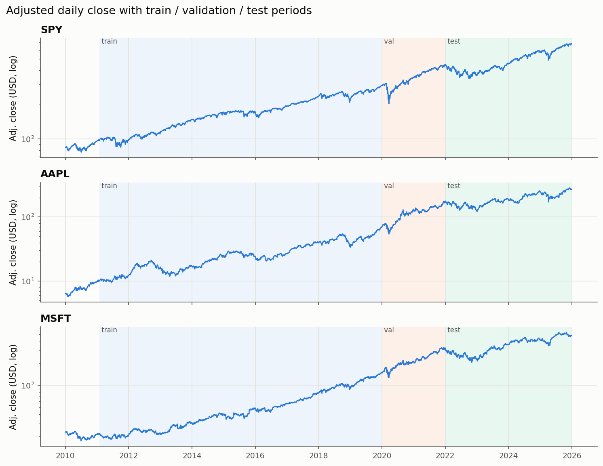

# Experiment Report: ML-Based Algorithmic Trading Signals

> Real market data (Yahoo Finance via `yfinance`). Historical backtest results are not a guarantee of future performance and are not investment advice.

Generated: 2026-10-12 | experiment `main` | total runtime 1434.3 s

## 1. Experiment configuration

| Setting | Value |
|---|---|
| Universe | SPY, AAPL, MSFT |
| Target | three_class, horizon 1 day(s), neutral band ±0.10% |
| Execution convention | next_open |
| Signal mode | long_only |
| Threshold selection | maximise validation sharpe (min exposure 5%) |
| Costs | 10 bps fee + 5 bps slippage per unit turnover |
| Initial capital | 100,000 |
| Annualisation / risk-free | 252 days / 0.00% |
| Tuning | purged TimeSeriesSplit, 4 folds, scored by log loss |
| Random seed | 42 |

Software: project_version 1.0.0, python 3.14.3, numpy 2.4.3, pandas 2.3.3, scikit_learn 1.8.0, xgboost 3.2.0, torch 2.11.0+cpu

## 2. Data sources and dates

| Ticker | Source | Rows | First date | Last date | SHA-256 (raw CSV) |
|---|---|---|---|---|---|
| SPY | cache | 4024 | 2010-01-04 | 2025-12-31 | 0ba56f9ea0fa8ac8… |
| AAPL | cache | 4024 | 2010-01-04 | 2025-12-31 | 199b5813151cb00b… |
| MSFT | cache | 4024 | 2010-01-04 | 2025-12-31 | d0f1bd6af9456ebb… |

`source = cache` means the file in `data/raw` written by an earlier yfinance download was reused. Prices are split- and dividend-adjusted (factor `Adj Close / Close` applied to OHLC).

## 3. Observations, features and chronological splits

| Ticker | Rows after warm-up | Features | Train | Validation | Test |
|---|---|---|---|---|---|
| SPY | 3753 | 42 | 2011-01-31 → 2019-12-27 (2243) | 2020-01-02 → 2021-12-29 (503) | 2022-01-03 → 2025-12-29 (1001) |
| AAPL | 3753 | 42 | 2011-01-31 → 2019-12-27 (2243) | 2020-01-02 → 2021-12-29 (503) | 2022-01-03 → 2025-12-29 (1001) |
| MSFT | 3753 | 42 | 2011-01-31 → 2019-12-27 (2243) | 2020-01-02 → 2021-12-29 (503) | 2022-01-03 → 2025-12-29 (1001) |

Rows whose label window crosses a split boundary are purged. The first rows of the download are consumed by indicator warm-up (252-day windows).

### Class distribution

| ticker | split | Down | Neutral | Up |
|---|---|---|---|---|
| AAPL | train | 42.53% | 6.55% | 50.91% |
| AAPL | val | 41.75% | 3.98% | 54.27% |
| AAPL | test | 43.96% | 6.59% | 49.45% |
| MSFT | train | 42.76% | 7.22% | 50.02% |
| MSFT | val | 43.94% | 4.97% | 51.09% |
| MSFT | test | 43.66% | 6.09% | 50.25% |
| SPY | train | 37.32% | 12.84% | 49.84% |
| SPY | val | 34.39% | 10.54% | 55.07% |
| SPY | test | 41.16% | 9.39% | 49.45% |

## 4. Models and selected hyperparameters

Hyperparameters were selected on training data only (purged time-series CV); the LSTM architecture and the ensemble members on the validation period; decision thresholds on the validation period.

| Ticker | Model | Selected parameters | Threshold τ (val) |
|---|---|---|---|
| SPY | logistic_regression | C=0.001, class_weight=None | 0.425 |
| SPY | random_forest | n_estimators=300, max_features=sqrt, max_depth=3, min_samples_leaf=80, class_weight=None | 0.300 |
| SPY | xgboost | subsample=0.8, colsample_bytree=0.8, min_child_weight=5, reg_lambda=1.0, max_depth=2, learning_rate=0.03, n_estimators=100, class_weight=None | 0.375 |
| SPY | lstm | seq_len=10, hidden_size=32, num_layers=1, dropout=0.2, learning_rate=0.001, weight_decay=0.0001, class_weight=None | 0.375 |
| SPY | ensemble | members=['logistic_regression', 'lstm'] | 0.300 |
| AAPL | logistic_regression | C=0.001, class_weight=None | 0.450 |
| AAPL | random_forest | n_estimators=300, max_features=sqrt, max_depth=3, min_samples_leaf=20, class_weight=None | 0.400 |
| AAPL | xgboost | subsample=0.8, colsample_bytree=0.8, min_child_weight=5, reg_lambda=1.0, max_depth=2, learning_rate=0.03, n_estimators=100, class_weight=None | 0.325 |
| AAPL | lstm | seq_len=10, hidden_size=16, num_layers=1, dropout=0.2, learning_rate=0.001, weight_decay=0.0001, class_weight=None | 0.400 |
| AAPL | ensemble | members=['random_forest', 'xgboost'] | 0.350 |
| MSFT | logistic_regression | C=0.001, class_weight=None | 0.375 |
| MSFT | random_forest | n_estimators=300, max_features=sqrt, max_depth=3, min_samples_leaf=80, class_weight=None | 0.300 |
| MSFT | xgboost | subsample=0.8, colsample_bytree=0.8, min_child_weight=5, reg_lambda=1.0, max_depth=2, learning_rate=0.03, n_estimators=100, class_weight=None | 0.400 |
| MSFT | lstm | seq_len=10, hidden_size=16, num_layers=1, dropout=0.2, learning_rate=0.001, weight_decay=0.0001, class_weight=None | 0.300 |
| MSFT | ensemble | members=['logistic_regression', 'random_forest'] | 0.425 |

## 5. Classification metrics (test period)

Macro averages weight Down, Neutral and Up equally. Log loss and Brier score use predicted probabilities (lower is better); naive persistence produces hard labels only.

| ticker | model | n | accuracy | balanced_accuracy | precision_macro | recall_macro | f1_macro | log_loss | brier |
|---|---|---|---|---|---|---|---|---|---|
| SPY | Majority class | 1001 | 0.495 | 0.333 | 0.165 | 0.333 | 0.221 | 0.943 | 0.580 |
| SPY | Logistic Regression | 1001 | 0.497 | 0.335 | 0.415 | 0.335 | 0.226 | 0.928 | 0.576 |
| SPY | Random Forest | 1001 | 0.494 | 0.333 | 0.165 | 0.333 | 0.220 | 0.930 | 0.577 |
| SPY | XGBoost | 1001 | 0.472 | 0.322 | 0.275 | 0.322 | 0.250 | 0.937 | 0.583 |
| SPY | LSTM | 1001 | 0.493 | 0.334 | 0.314 | 0.334 | 0.238 | 0.932 | 0.580 |
| SPY | Ensemble (soft vote) | 1001 | 0.493 | 0.332 | 0.248 | 0.332 | 0.221 | 0.929 | 0.577 |
| SPY | Naive persistence | 1001 | 0.420 | 0.335 | 0.335 | 0.335 | 0.335 | N/A | N/A |
| AAPL | Majority class | 1001 | 0.495 | 0.333 | 0.165 | 0.333 | 0.221 | 0.889 | 0.558 |
| AAPL | Logistic Regression | 1001 | 0.473 | 0.324 | 0.298 | 0.324 | 0.276 | 0.889 | 0.560 |
| AAPL | Random Forest | 1001 | 0.493 | 0.335 | 0.322 | 0.335 | 0.260 | 0.889 | 0.558 |
| AAPL | XGBoost | 1001 | 0.489 | 0.334 | 0.315 | 0.334 | 0.280 | 0.891 | 0.561 |
| AAPL | LSTM | 1001 | 0.485 | 0.334 | 0.316 | 0.334 | 0.294 | 0.900 | 0.564 |
| AAPL | Ensemble (soft vote) | 1001 | 0.494 | 0.336 | 0.323 | 0.336 | 0.269 | 0.889 | 0.559 |
| AAPL | Naive persistence | 1001 | 0.457 | 0.338 | 0.337 | 0.338 | 0.337 | N/A | N/A |
| MSFT | Majority class | 1001 | 0.502 | 0.333 | 0.167 | 0.333 | 0.223 | 0.879 | 0.553 |
| MSFT | Logistic Regression | 1001 | 0.510 | 0.351 | 0.335 | 0.351 | 0.326 | 0.876 | 0.552 |
| MSFT | Random Forest | 1001 | 0.500 | 0.343 | 0.325 | 0.343 | 0.313 | 0.877 | 0.552 |
| MSFT | XGBoost | 1001 | 0.507 | 0.347 | 0.330 | 0.347 | 0.316 | 0.875 | 0.550 |
| MSFT | LSTM | 1001 | 0.500 | 0.345 | 0.326 | 0.345 | 0.324 | 0.883 | 0.556 |
| MSFT | Ensemble (soft vote) | 1001 | 0.505 | 0.347 | 0.329 | 0.347 | 0.320 | 0.876 | 0.552 |
| MSFT | Naive persistence | 1001 | 0.443 | 0.327 | 0.327 | 0.327 | 0.327 | N/A | N/A |

## 6. Trading metrics (test period, net of costs)

ML strategies use the confidence rule (long if P(Up) ≥ τ, τ chosen on validation); "argmax" variants trade the predicted class directly.

| ticker | strategy | threshold | cumulative_return | annualized_return | annualized_volatility | sharpe | sortino | max_drawdown | win_rate | exposure | turnover_annual | n_trades | costs_paid |
|---|---|---|---|---|---|---|---|---|---|---|---|---|---|
| SPY | Buy & Hold | N/A | 51.36% | 11.00% | 18.32% | 0.661 | 0.945 | -26.40% | 53.55% | 100.00% | 0.3 | 1 | 150 |
| SPY | MA Crossover (10/50) | N/A | 23.35% | 5.42% | 11.45% | 0.519 | 0.720 | -14.00% | 53.94% | 67.23% | 6.8 | 27 | 4030 |
| SPY | Naive persistence | N/A | -47.92% | -15.15% | 11.15% | -1.416 | -1.792 | -50.12% | 50.19% | 53.95% | 123.9 | 492 | 53132 |
| SPY | Logistic Regression (conf.) | 0.425 | 51.36% | 11.00% | 18.32% | 0.661 | 0.945 | -26.40% | 53.55% | 100.00% | 0.3 | 1 | 150 |
| SPY | Logistic Regression (argmax) | N/A | 62.03% | 12.92% | 18.04% | 0.764 | 1.104 | -27.03% | 53.66% | 99.60% | 2.3 | 9 | 1359 |
| SPY | Random Forest (conf.) | 0.300 | 51.36% | 11.00% | 18.32% | 0.661 | 0.945 | -26.40% | 53.55% | 100.00% | 0.3 | 1 | 150 |
| SPY | Random Forest (argmax) | N/A | 50.70% | 10.88% | 18.32% | 0.655 | 0.936 | -26.40% | 53.50% | 99.90% | 0.8 | 3 | 569 |
| SPY | XGBoost (conf.) | 0.375 | 45.16% | 9.84% | 18.30% | 0.604 | 0.862 | -26.47% | 53.52% | 97.80% | 8.8 | 35 | 5366 |
| SPY | XGBoost (argmax) | N/A | 6.93% | 1.70% | 17.92% | 0.184 | 0.259 | -33.31% | 52.53% | 90.91% | 29.0 | 115 | 14994 |
| SPY | LSTM (conf.) | 0.375 | 48.59% | 10.48% | 18.31% | 0.636 | 0.909 | -26.40% | 53.41% | 99.70% | 0.8 | 3 | 549 |
| SPY | LSTM (argmax) | N/A | 43.44% | 9.51% | 18.16% | 0.591 | 0.843 | -25.53% | 53.40% | 97.10% | 8.3 | 33 | 5110 |
| SPY | Ensemble (soft vote) (conf.) | 0.300 | 51.36% | 11.00% | 18.32% | 0.661 | 0.945 | -26.40% | 53.55% | 100.00% | 0.3 | 1 | 150 |
| SPY | Ensemble (soft vote) (argmax) | N/A | 49.84% | 10.72% | 18.29% | 0.648 | 0.926 | -26.40% | 53.46% | 99.60% | 2.3 | 9 | 1520 |
| AAPL | Buy & Hold | N/A | 52.42% | 11.19% | 29.66% | 0.506 | 0.732 | -33.33% | 53.15% | 100.00% | 0.3 | 1 | 150 |
| AAPL | MA Crossover (10/50) | N/A | 24.02% | 5.57% | 17.83% | 0.393 | 0.562 | -25.39% | 53.64% | 56.24% | 7.8 | 31 | 4463 |
| AAPL | Naive persistence | N/A | -43.31% | -13.31% | 18.53% | -0.678 | -0.887 | -55.08% | 52.35% | 53.05% | 122.1 | 485 | 48724 |
| AAPL | Logistic Regression (conf.) | 0.450 | 43.22% | 9.46% | 28.23% | 0.461 | 0.672 | -35.20% | 53.65% | 93.11% | 28.4 | 113 | 15044 |
| AAPL | Logistic Regression (argmax) | N/A | -25.61% | -7.18% | 25.48% | -0.165 | -0.228 | -38.95% | 51.85% | 83.82% | 55.6 | 221 | 24498 |
| AAPL | Random Forest (conf.) | 0.400 | 61.28% | 12.79% | 29.26% | 0.557 | 0.811 | -34.80% | 53.35% | 98.50% | 7.8 | 31 | 4234 |
| AAPL | Random Forest (argmax) | N/A | 32.52% | 7.34% | 28.28% | 0.392 | 0.567 | -37.00% | 53.18% | 92.61% | 30.0 | 119 | 16534 |
| AAPL | XGBoost (conf.) | 0.325 | 54.54% | 11.58% | 29.46% | 0.519 | 0.753 | -33.46% | 53.29% | 98.80% | 6.3 | 25 | 3411 |
| AAPL | XGBoost (argmax) | N/A | 8.71% | 2.12% | 25.76% | 0.210 | 0.301 | -32.22% | 52.76% | 86.71% | 47.1 | 187 | 23267 |
| AAPL | LSTM (conf.) | 0.400 | 38.46% | 8.54% | 29.40% | 0.425 | 0.614 | -35.71% | 52.91% | 97.80% | 9.3 | 37 | 5405 |
| AAPL | LSTM (argmax) | N/A | 39.12% | 8.67% | 26.85% | 0.443 | 0.650 | -33.60% | 52.76% | 81.42% | 48.1 | 191 | 27567 |
| AAPL | Ensemble (soft vote) (conf.) | 0.350 | 56.29% | 11.90% | 29.46% | 0.529 | 0.767 | -33.33% | 53.28% | 99.00% | 5.3 | 21 | 2740 |
| AAPL | Ensemble (soft vote) (argmax) | N/A | 30.21% | 6.87% | 27.74% | 0.378 | 0.551 | -35.75% | 53.08% | 90.71% | 38.0 | 151 | 20795 |
| MSFT | Buy & Hold | N/A | 50.35% | 10.81% | 27.57% | 0.510 | 0.749 | -34.70% | 53.95% | 100.00% | 0.3 | 1 | 150 |
| MSFT | MA Crossover (10/50) | N/A | 11.63% | 2.81% | 17.37% | 0.246 | 0.361 | -27.85% | 53.92% | 54.85% | 7.0 | 28 | 4113 |
| MSFT | Naive persistence | N/A | -45.57% | -14.20% | 19.44% | -0.690 | -0.976 | -51.61% | 51.63% | 52.25% | 125.4 | 498 | 54741 |
| MSFT | Logistic Regression (conf.) | 0.375 | 46.65% | 10.12% | 27.48% | 0.488 | 0.716 | -34.63% | 53.91% | 98.40% | 5.8 | 23 | 3116 |
| MSFT | Logistic Regression (argmax) | N/A | 58.48% | 12.29% | 23.85% | 0.605 | 0.900 | -23.85% | 55.02% | 74.63% | 38.0 | 151 | 27896 |
| MSFT | Random Forest (conf.) | 0.300 | 50.35% | 10.81% | 27.57% | 0.510 | 0.749 | -34.70% | 53.95% | 100.00% | 0.3 | 1 | 150 |
| MSFT | Random Forest (argmax) | N/A | 35.50% | 7.95% | 24.68% | 0.432 | 0.649 | -30.43% | 54.10% | 76.82% | 32.0 | 127 | 21066 |
| MSFT | XGBoost (conf.) | 0.400 | 51.85% | 11.09% | 27.49% | 0.519 | 0.763 | -34.70% | 54.18% | 98.10% | 7.3 | 29 | 5314 |
| MSFT | XGBoost (argmax) | N/A | 18.86% | 4.44% | 25.33% | 0.298 | 0.438 | -41.84% | 54.63% | 77.72% | 43.6 | 173 | 24176 |
| MSFT | LSTM (conf.) | 0.300 | 50.35% | 10.81% | 27.57% | 0.510 | 0.749 | -34.70% | 53.95% | 100.00% | 0.3 | 1 | 150 |
| MSFT | LSTM (argmax) | N/A | 34.47% | 7.74% | 24.31% | 0.428 | 0.632 | -24.26% | 54.49% | 71.13% | 37.0 | 147 | 24333 |
| MSFT | Ensemble (soft vote) (conf.) | 0.425 | 28.35% | 6.49% | 27.14% | 0.367 | 0.537 | -36.12% | 53.59% | 94.71% | 12.3 | 49 | 6503 |
| MSFT | Ensemble (soft vote) (argmax) | N/A | 38.92% | 8.63% | 24.01% | 0.464 | 0.684 | -30.61% | 54.91% | 75.32% | 31.5 | 125 | 21295 |

## 7. Comparison with baselines (averaged over tickers)

| strategy | accuracy | f1_macro | cumulative_return | sharpe | sortino | max_drawdown | turnover_annual | n_trades |
|---|---|---|---|---|---|---|---|---|
| Buy & Hold | N/A | N/A | 51.38% | 0.559 | 0.808 | -31.48% | 0.3 | 1.0 |
| MA Crossover (10/50) | N/A | N/A | 19.67% | 0.386 | 0.547 | -22.41% | 7.2 | 28.7 |
| Naive persistence | 0.440 | 0.333 | -45.60% | -0.928 | -1.218 | -52.27% | 123.8 | 491.7 |
| Logistic Regression (conf.) | 0.493 | 0.276 | 47.07% | 0.537 | 0.778 | -32.07% | 11.5 | 45.7 |
| Random Forest (conf.) | 0.496 | 0.265 | 54.33% | 0.576 | 0.835 | -31.96% | 2.8 | 11.0 |
| XGBoost (conf.) | 0.489 | 0.282 | 50.51% | 0.548 | 0.793 | -31.54% | 7.5 | 29.7 |
| LSTM (conf.) | 0.493 | 0.285 | 45.80% | 0.524 | 0.757 | -32.27% | 3.4 | 13.7 |
| Ensemble (soft vote) (conf.) | 0.497 | 0.270 | 45.33% | 0.519 | 0.749 | -31.95% | 6.0 | 23.7 |

### Block-bootstrap 95% confidence intervals

Circular block bootstrap (block 20 days, 2000 resamples) of daily test returns / prediction outcomes.

| ticker | strategy | statistic | estimate | low | high |
|---|---|---|---|---|---|
| SPY | Buy & Hold | sharpe | 0.661 | -0.213 | 1.582 |
| SPY | MA Crossover (10/50) | sharpe | 0.519 | -0.412 | 1.555 |
| SPY | MA Crossover (10/50) | sharpe_minus_buy_and_hold | -0.143 | -0.877 | 0.567 |
| SPY | Naive persistence | sharpe | -1.416 | -2.470 | -0.390 |
| SPY | Naive persistence | sharpe_minus_buy_and_hold | -2.077 | -2.867 | -1.302 |
| SPY | Logistic Regression (conf.) | sharpe | 0.661 | -0.198 | 1.540 |
| SPY | Logistic Regression (conf.) | sharpe_minus_buy_and_hold | 0.000 | 0.000 | 0.000 |
| SPY | Random Forest (conf.) | sharpe | 0.661 | -0.143 | 1.581 |
| SPY | Random Forest (conf.) | sharpe_minus_buy_and_hold | 0.000 | 0.000 | 0.000 |
| SPY | XGBoost (conf.) | sharpe | 0.604 | -0.218 | 1.561 |
| SPY | XGBoost (conf.) | sharpe_minus_buy_and_hold | -0.057 | -0.128 | -0.005 |
| SPY | LSTM (conf.) | sharpe | 0.636 | -0.192 | 1.594 |
| SPY | LSTM (conf.) | sharpe_minus_buy_and_hold | -0.025 | -0.088 | 0.000 |
| SPY | Ensemble (soft vote) (conf.) | sharpe | 0.661 | -0.161 | 1.563 |
| SPY | Ensemble (soft vote) (conf.) | sharpe_minus_buy_and_hold | 0.000 | 0.000 | 0.000 |
| SPY | Logistic Regression | accuracy_minus_majority_class | 0.002 | -0.002 | 0.007 |
| SPY | Random Forest | accuracy_minus_majority_class | -0.001 | -0.003 | 0.000 |
| SPY | XGBoost | accuracy_minus_majority_class | -0.023 | -0.040 | -0.008 |
| SPY | LSTM | accuracy_minus_majority_class | -0.002 | -0.012 | 0.007 |
| SPY | Ensemble (soft vote) | accuracy_minus_majority_class | -0.002 | -0.006 | 0.001 |
| AAPL | Buy & Hold | sharpe | 0.506 | -0.346 | 1.379 |
| AAPL | MA Crossover (10/50) | sharpe | 0.393 | -0.617 | 1.403 |
| AAPL | MA Crossover (10/50) | sharpe_minus_buy_and_hold | -0.113 | -0.876 | 0.591 |
| AAPL | Naive persistence | sharpe | -0.678 | -1.790 | 0.447 |
| AAPL | Naive persistence | sharpe_minus_buy_and_hold | -1.184 | -1.971 | -0.407 |
| AAPL | Logistic Regression (conf.) | sharpe | 0.461 | -0.435 | 1.345 |
| AAPL | Logistic Regression (conf.) | sharpe_minus_buy_and_hold | -0.045 | -0.400 | 0.299 |
| AAPL | Random Forest (conf.) | sharpe | 0.557 | -0.265 | 1.442 |
| AAPL | Random Forest (conf.) | sharpe_minus_buy_and_hold | 0.051 | -0.114 | 0.227 |
| AAPL | XGBoost (conf.) | sharpe | 0.519 | -0.268 | 1.410 |
| AAPL | XGBoost (conf.) | sharpe_minus_buy_and_hold | 0.013 | -0.086 | 0.133 |
| AAPL | LSTM (conf.) | sharpe | 0.425 | -0.417 | 1.349 |
| AAPL | LSTM (conf.) | sharpe_minus_buy_and_hold | -0.080 | -0.217 | 0.044 |
| AAPL | Ensemble (soft vote) (conf.) | sharpe | 0.529 | -0.300 | 1.485 |
| AAPL | Ensemble (soft vote) (conf.) | sharpe_minus_buy_and_hold | 0.023 | -0.077 | 0.136 |
| AAPL | Logistic Regression | accuracy_minus_majority_class | -0.022 | -0.050 | 0.009 |
| AAPL | Random Forest | accuracy_minus_majority_class | -0.002 | -0.019 | 0.015 |
| AAPL | XGBoost | accuracy_minus_majority_class | -0.006 | -0.031 | 0.020 |
| AAPL | LSTM | accuracy_minus_majority_class | -0.010 | -0.036 | 0.017 |
| AAPL | Ensemble (soft vote) | accuracy_minus_majority_class | -0.001 | -0.022 | 0.021 |
| MSFT | Buy & Hold | sharpe | 0.510 | -0.308 | 1.344 |
| MSFT | MA Crossover (10/50) | sharpe | 0.246 | -0.719 | 1.267 |
| MSFT | MA Crossover (10/50) | sharpe_minus_buy_and_hold | -0.264 | -0.900 | 0.386 |
| MSFT | Naive persistence | sharpe | -0.690 | -1.708 | 0.259 |
| MSFT | Naive persistence | sharpe_minus_buy_and_hold | -1.200 | -1.882 | -0.583 |
| MSFT | Logistic Regression (conf.) | sharpe | 0.488 | -0.329 | 1.299 |
| MSFT | Logistic Regression (conf.) | sharpe_minus_buy_and_hold | -0.022 | -0.111 | 0.060 |
| MSFT | Random Forest (conf.) | sharpe | 0.510 | -0.309 | 1.345 |
| MSFT | Random Forest (conf.) | sharpe_minus_buy_and_hold | 0.000 | 0.000 | 0.000 |
| MSFT | XGBoost (conf.) | sharpe | 0.519 | -0.269 | 1.296 |
| MSFT | XGBoost (conf.) | sharpe_minus_buy_and_hold | 0.010 | -0.041 | 0.062 |
| MSFT | LSTM (conf.) | sharpe | 0.510 | -0.302 | 1.403 |
| MSFT | LSTM (conf.) | sharpe_minus_buy_and_hold | 0.000 | 0.000 | 0.000 |
| MSFT | Ensemble (soft vote) (conf.) | sharpe | 0.367 | -0.383 | 1.144 |
| MSFT | Ensemble (soft vote) (conf.) | sharpe_minus_buy_and_hold | -0.143 | -0.301 | 0.002 |
| MSFT | Logistic Regression | accuracy_minus_majority_class | 0.008 | -0.023 | 0.038 |
| MSFT | Random Forest | accuracy_minus_majority_class | -0.002 | -0.033 | 0.029 |
| MSFT | XGBoost | accuracy_minus_majority_class | 0.005 | -0.027 | 0.037 |
| MSFT | LSTM | accuracy_minus_majority_class | -0.002 | -0.039 | 0.032 |
| MSFT | Ensemble (soft vote) | accuracy_minus_majority_class | 0.003 | -0.028 | 0.032 |

## 8. Walk-forward evaluation (expanding window, annual retraining)

For each test year Y in 2016-2025: train on all years before Y-1, select thresholds / early-stop on Y-1, test on Y. Hyperparameters are re-tuned in every fold with reduced grids. Out-of-sample years are concatenated into one continuous backtest.

| ticker | strategy | start | end | cumulative_return | annualized_return | sharpe | sortino | max_drawdown | exposure | n_trades |
|---|---|---|---|---|---|---|---|---|---|---|
| SPY | Buy & Hold | 2016-01-04 | 2025-12-29 | 301.95% | 14.98% | 0.896 | 1.242 | -32.05% | 100.00% | 1 |
| SPY | MA Crossover (10/50) | 2016-01-04 | 2025-12-29 | 118.26% | 8.14% | 0.744 | 1.015 | -15.51% | 72.77% | 57 |
| SPY | Logistic Regression (conf.) | 2016-01-04 | 2025-12-29 | 50.34% | 4.17% | 0.339 | 0.458 | -41.69% | 68.63% | 115 |
| SPY | Random Forest (conf.) | 2016-01-04 | 2025-12-29 | 183.47% | 11.02% | 0.702 | 0.969 | -36.20% | 89.17% | 75 |
| SPY | XGBoost (conf.) | 2016-01-04 | 2025-12-29 | 70.02% | 5.47% | 0.409 | 0.559 | -40.50% | 75.48% | 221 |
| SPY | LSTM (conf.) | 2016-01-04 | 2025-12-29 | 97.45% | 7.06% | 0.509 | 0.697 | -32.97% | 65.96% | 69 |
| SPY | Ensemble (soft vote) (conf.) | 2016-01-04 | 2025-12-29 | 84.14% | 6.32% | 0.464 | 0.636 | -39.30% | 64.73% | 79 |
| AAPL | Buy & Hold | 2016-01-04 | 2025-12-29 | 1043.51% | 27.69% | 0.981 | 1.429 | -37.39% | 100.00% | 1 |
| AAPL | MA Crossover (10/50) | 2016-01-04 | 2025-12-29 | 400.26% | 17.53% | 0.875 | 1.285 | -28.97% | 64.65% | 63 |
| AAPL | Logistic Regression (conf.) | 2016-01-04 | 2025-12-29 | 149.47% | 9.60% | 0.495 | 0.715 | -45.87% | 66.12% | 347 |
| AAPL | Random Forest (conf.) | 2016-01-04 | 2025-12-29 | 580.47% | 21.21% | 0.895 | 1.337 | -37.90% | 69.79% | 249 |
| AAPL | XGBoost (conf.) | 2016-01-04 | 2025-12-29 | 105.68% | 7.50% | 0.415 | 0.599 | -50.81% | 59.71% | 331 |
| AAPL | LSTM (conf.) | 2016-01-04 | 2025-12-29 | 160.53% | 10.08% | 0.501 | 0.729 | -48.11% | 64.53% | 155 |
| AAPL | Ensemble (soft vote) (conf.) | 2016-01-04 | 2025-12-29 | 202.78% | 11.75% | 0.559 | 0.814 | -50.31% | 68.07% | 177 |
| MSFT | Buy & Hold | 2016-01-04 | 2025-12-29 | 912.76% | 26.15% | 1.032 | 1.515 | -36.46% | 100.00% | 1 |
| MSFT | MA Crossover (10/50) | 2016-01-04 | 2025-12-29 | 217.58% | 12.29% | 0.705 | 1.028 | -33.53% | 71.26% | 66 |
| MSFT | Logistic Regression (conf.) | 2016-01-04 | 2025-12-29 | 272.87% | 14.11% | 0.759 | 1.127 | -22.87% | 58.12% | 359 |
| MSFT | Random Forest (conf.) | 2016-01-04 | 2025-12-29 | 183.27% | 11.01% | 0.566 | 0.815 | -36.15% | 72.81% | 177 |
| MSFT | XGBoost (conf.) | 2016-01-04 | 2025-12-29 | 99.19% | 7.16% | 0.418 | 0.597 | -40.22% | 72.53% | 277 |
| MSFT | LSTM (conf.) | 2016-01-04 | 2025-12-29 | 274.32% | 14.16% | 0.692 | 1.008 | -36.30% | 71.50% | 143 |
| MSFT | Ensemble (soft vote) (conf.) | 2016-01-04 | 2025-12-29 | 151.10% | 9.68% | 0.521 | 0.751 | -38.21% | 68.35% | 197 |

| ticker | model | period | n | accuracy | balanced_accuracy | f1_macro | log_loss |
|---|---|---|---|---|---|---|---|
| SPY | Logistic Regression | 2016-2025 | 2512 | 0.494 | 0.332 | 0.256 | 0.962 |
| SPY | Random Forest | 2016-2025 | 2512 | 0.497 | 0.331 | 0.238 | 0.962 |
| SPY | XGBoost | 2016-2025 | 2512 | 0.464 | 0.325 | 0.289 | 0.981 |
| SPY | LSTM | 2016-2025 | 2512 | 0.493 | 0.334 | 0.265 | 0.965 |
| SPY | Ensemble (soft vote) | 2016-2025 | 2512 | 0.490 | 0.330 | 0.254 | 0.962 |
| SPY | Majority class | 2016-2025 | 2512 | 0.504 | 0.333 | 0.223 | 0.971 |
| AAPL | Logistic Regression | 2016-2025 | 2512 | 0.488 | 0.336 | 0.321 | 0.894 |
| AAPL | Random Forest | 2016-2025 | 2512 | 0.505 | 0.334 | 0.287 | 0.884 |
| AAPL | XGBoost | 2016-2025 | 2512 | 0.484 | 0.336 | 0.322 | 0.901 |
| AAPL | LSTM | 2016-2025 | 2512 | 0.498 | 0.337 | 0.313 | 0.895 |
| AAPL | Ensemble (soft vote) | 2016-2025 | 2512 | 0.490 | 0.333 | 0.312 | 0.888 |
| AAPL | Majority class | 2016-2025 | 2512 | 0.519 | 0.333 | 0.228 | 0.885 |
| MSFT | Logistic Regression | 2016-2025 | 2512 | 0.496 | 0.349 | 0.336 | 0.896 |
| MSFT | Random Forest | 2016-2025 | 2512 | 0.501 | 0.345 | 0.324 | 0.892 |
| MSFT | XGBoost | 2016-2025 | 2512 | 0.486 | 0.338 | 0.323 | 0.915 |
| MSFT | LSTM | 2016-2025 | 2512 | 0.498 | 0.345 | 0.328 | 0.897 |
| MSFT | Ensemble (soft vote) | 2016-2025 | 2512 | 0.498 | 0.348 | 0.334 | 0.894 |
| MSFT | Majority class | 2016-2025 | 2512 | 0.513 | 0.333 | 0.226 | 0.892 |

## 9. Robustness analyses

### Transaction-cost sensitivity (test Sharpe ratio)

Columns are the total one-way cost (fee + slippage) charged per unit of turnover; entering and later exiting a position (a round trip) costs twice this. Positions are held fixed; only the cost assumption changes.

| ticker | strategy | 0 bps | 5 bps | 10 bps | 20 bps | 40 bps |
|---|---|---|---|---|---|---|
| SPY | Buy & Hold | 0.663 | 0.663 | 0.662 | 0.661 | 0.658 |
| SPY | MA Crossover (10/50) | 0.608 | 0.578 | 0.548 | 0.489 | 0.370 |
| SPY | Naive persistence | 0.251 | -0.307 | -0.863 | -1.963 | -4.061 |
| SPY | Logistic Regression (conf.) | 0.663 | 0.663 | 0.662 | 0.661 | 0.658 |
| SPY | Random Forest (conf.) | 0.663 | 0.663 | 0.662 | 0.661 | 0.658 |
| SPY | XGBoost (conf.) | 0.677 | 0.653 | 0.628 | 0.580 | 0.483 |
| SPY | LSTM (conf.) | 0.642 | 0.640 | 0.638 | 0.634 | 0.626 |
| SPY | Ensemble (soft vote) (conf.) | 0.663 | 0.663 | 0.662 | 0.661 | 0.658 |
| AAPL | Buy & Hold | 0.507 | 0.507 | 0.506 | 0.505 | 0.504 |
| AAPL | MA Crossover (10/50) | 0.459 | 0.437 | 0.415 | 0.371 | 0.283 |
| AAPL | Naive persistence | 0.311 | -0.018 | -0.348 | -1.007 | -2.306 |
| AAPL | Logistic Regression (conf.) | 0.612 | 0.562 | 0.511 | 0.411 | 0.209 |
| AAPL | Random Forest (conf.) | 0.597 | 0.584 | 0.571 | 0.544 | 0.491 |
| AAPL | XGBoost (conf.) | 0.551 | 0.540 | 0.530 | 0.508 | 0.465 |
| AAPL | LSTM (conf.) | 0.473 | 0.457 | 0.441 | 0.409 | 0.346 |
| AAPL | Ensemble (soft vote) (conf.) | 0.555 | 0.547 | 0.538 | 0.520 | 0.484 |
| MSFT | Buy & Hold | 0.511 | 0.511 | 0.510 | 0.509 | 0.507 |
| MSFT | MA Crossover (10/50) | 0.307 | 0.287 | 0.266 | 0.226 | 0.144 |
| MSFT | Naive persistence | 0.277 | -0.045 | -0.368 | -1.012 | -2.287 |
| MSFT | Logistic Regression (conf.) | 0.519 | 0.509 | 0.498 | 0.477 | 0.435 |
| MSFT | Random Forest (conf.) | 0.511 | 0.511 | 0.510 | 0.509 | 0.507 |
| MSFT | XGBoost (conf.) | 0.559 | 0.546 | 0.533 | 0.506 | 0.453 |
| MSFT | LSTM (conf.) | 0.511 | 0.511 | 0.510 | 0.509 | 0.507 |
| MSFT | Ensemble (soft vote) (conf.) | 0.435 | 0.412 | 0.389 | 0.344 | 0.253 |

### Fixed vs volatility-targeted position sizing (test)

| ticker | strategy | sizing | cumulative_return | annualized_return | annualized_volatility | sharpe | sortino | max_drawdown | turnover_annual |
|---|---|---|---|---|---|---|---|---|---|
| SPY | Buy & Hold | fixed (0/1) | 51.36% | 11.00% | 18.32% | 0.661 | 0.945 | -26.40% | 0.3 |
| SPY | Buy & Hold | vol target 15% | 39.87% | 8.81% | 14.09% | 0.670 | 0.930 | -20.76% | 3.1 |
| SPY | Logistic Regression (conf.) | fixed (0/1) | 51.36% | 11.00% | 18.32% | 0.661 | 0.945 | -26.40% | 0.3 |
| SPY | Logistic Regression (conf.) | vol target 15% | 39.87% | 8.81% | 14.09% | 0.670 | 0.930 | -20.76% | 3.1 |
| SPY | Random Forest (conf.) | fixed (0/1) | 51.36% | 11.00% | 18.32% | 0.661 | 0.945 | -26.40% | 0.3 |
| SPY | Random Forest (conf.) | vol target 15% | 39.87% | 8.81% | 14.09% | 0.670 | 0.930 | -20.76% | 3.1 |
| SPY | XGBoost (conf.) | fixed (0/1) | 45.16% | 9.84% | 18.30% | 0.604 | 0.862 | -26.47% | 8.8 |
| SPY | XGBoost (conf.) | vol target 15% | 35.67% | 7.98% | 14.08% | 0.616 | 0.854 | -20.84% | 9.5 |
| SPY | LSTM (conf.) | fixed (0/1) | 48.59% | 10.48% | 18.31% | 0.636 | 0.909 | -26.40% | 0.8 |
| SPY | LSTM (conf.) | vol target 15% | 37.31% | 8.31% | 14.08% | 0.638 | 0.884 | -20.76% | 3.6 |
| SPY | Ensemble (soft vote) (conf.) | fixed (0/1) | 51.36% | 11.00% | 18.32% | 0.661 | 0.945 | -26.40% | 0.3 |
| SPY | Ensemble (soft vote) (conf.) | vol target 15% | 39.87% | 8.81% | 14.09% | 0.670 | 0.930 | -20.76% | 3.1 |
| AAPL | Buy & Hold | fixed (0/1) | 52.42% | 11.19% | 29.66% | 0.506 | 0.732 | -33.33% | 0.3 |
| AAPL | Buy & Hold | vol target 15% | 36.23% | 8.09% | 16.93% | 0.544 | 0.782 | -20.51% | 5.7 |
| AAPL | Logistic Regression (conf.) | fixed (0/1) | 43.22% | 9.46% | 28.23% | 0.461 | 0.672 | -35.20% | 28.4 |
| AAPL | Logistic Regression (conf.) | vol target 15% | 29.51% | 6.73% | 16.50% | 0.477 | 0.686 | -21.30% | 18.0 |
| AAPL | Random Forest (conf.) | fixed (0/1) | 61.28% | 12.79% | 29.26% | 0.557 | 0.811 | -34.80% | 7.8 |
| AAPL | Random Forest (conf.) | vol target 15% | 37.56% | 8.36% | 16.83% | 0.561 | 0.807 | -21.37% | 8.4 |
| AAPL | XGBoost (conf.) | fixed (0/1) | 54.54% | 11.58% | 29.46% | 0.519 | 0.753 | -33.46% | 6.3 |
| AAPL | XGBoost (conf.) | vol target 15% | 36.91% | 8.23% | 16.87% | 0.553 | 0.795 | -20.59% | 8.2 |
| AAPL | LSTM (conf.) | fixed (0/1) | 38.46% | 8.54% | 29.40% | 0.425 | 0.614 | -35.71% | 9.3 |
| AAPL | LSTM (conf.) | vol target 15% | 31.47% | 7.13% | 16.85% | 0.493 | 0.708 | -21.98% | 9.1 |
| AAPL | Ensemble (soft vote) (conf.) | fixed (0/1) | 56.29% | 11.90% | 29.46% | 0.529 | 0.767 | -33.33% | 5.3 |
| AAPL | Ensemble (soft vote) (conf.) | vol target 15% | 37.77% | 8.40% | 16.87% | 0.562 | 0.809 | -20.51% | 7.7 |
| MSFT | Buy & Hold | fixed (0/1) | 50.35% | 10.81% | 27.57% | 0.510 | 0.749 | -34.70% | 0.3 |
| MSFT | Buy & Hold | vol target 15% | 30.59% | 6.95% | 17.14% | 0.478 | 0.695 | -19.49% | 5.8 |
| MSFT | Logistic Regression (conf.) | fixed (0/1) | 46.65% | 10.12% | 27.48% | 0.488 | 0.716 | -34.63% | 5.8 |
| MSFT | Logistic Regression (conf.) | vol target 15% | 29.99% | 6.83% | 17.11% | 0.471 | 0.686 | -19.71% | 8.0 |
| MSFT | Random Forest (conf.) | fixed (0/1) | 50.35% | 10.81% | 27.57% | 0.510 | 0.749 | -34.70% | 0.3 |
| MSFT | Random Forest (conf.) | vol target 15% | 30.59% | 6.95% | 17.14% | 0.478 | 0.695 | -19.49% | 5.8 |
| MSFT | XGBoost (conf.) | fixed (0/1) | 51.85% | 11.09% | 27.49% | 0.519 | 0.763 | -34.70% | 7.3 |
| MSFT | XGBoost (conf.) | vol target 15% | 32.63% | 7.37% | 17.06% | 0.502 | 0.732 | -19.49% | 11.4 |
| MSFT | LSTM (conf.) | fixed (0/1) | 50.35% | 10.81% | 27.57% | 0.510 | 0.749 | -34.70% | 0.3 |
| MSFT | LSTM (conf.) | vol target 15% | 30.59% | 6.95% | 17.14% | 0.478 | 0.695 | -19.49% | 5.8 |
| MSFT | Ensemble (soft vote) (conf.) | fixed (0/1) | 28.35% | 6.49% | 27.14% | 0.367 | 0.537 | -36.12% | 12.3 |
| MSFT | Ensemble (soft vote) (conf.) | vol target 15% | 21.51% | 5.03% | 16.97% | 0.374 | 0.542 | -20.62% | 11.5 |

### Sensitivity to execution timing and target definition (tabular models + ensemble, reduced grids, no LSTM)

`next_open` = signal after the close of day t, filled at the next open (default). `market-on-close` = idealised fill at the same close that generated the signal (optimistic). `binary` = Up/Down target without a neutral band. Accuracy is not comparable between 3-class and 2-class targets; compare each model with the majority-class row of the same variant.

**Test Sharpe ratio**

| ticker | strategy | default: next_open, three_class | market-on-close, three_class | next_open, binary target |
|---|---|---|---|---|
| SPY | Buy & Hold | 0.661 | 0.662 | 0.661 |
| SPY | MA Crossover (10/50) | 0.519 | 0.631 | 0.519 |
| SPY | Naive persistence | -1.416 | -1.298 | -1.416 |
| SPY | Logistic Regression (conf.) | 0.682 | 0.725 | 0.682 |
| SPY | Random Forest (conf.) | 0.661 | 0.662 | 0.661 |
| SPY | XGBoost (conf.) | 0.529 | 0.553 | 0.624 |
| SPY | Ensemble (soft vote) (conf.) | 0.661 | 0.657 | 0.661 |
| AAPL | Buy & Hold | 0.506 | 0.512 | 0.506 |
| AAPL | MA Crossover (10/50) | 0.393 | 0.363 | 0.393 |
| AAPL | Naive persistence | -0.678 | -0.538 | -0.678 |
| AAPL | Logistic Regression (conf.) | -0.013 | 0.393 | 0.629 |
| AAPL | Random Forest (conf.) | 0.584 | 0.011 | 0.545 |
| AAPL | XGBoost (conf.) | 0.295 | 0.539 | -1.038 |
| AAPL | Ensemble (soft vote) (conf.) | 0.565 | 0.253 | -0.972 |
| MSFT | Buy & Hold | 0.510 | 0.509 | 0.510 |
| MSFT | MA Crossover (10/50) | 0.246 | 0.297 | 0.246 |
| MSFT | Naive persistence | -0.690 | -0.892 | -0.690 |
| MSFT | Logistic Regression (conf.) | 0.482 | 0.522 | 0.524 |
| MSFT | Random Forest (conf.) | 0.510 | -0.040 | 0.534 |
| MSFT | XGBoost (conf.) | 0.383 | 0.479 | 0.385 |
| MSFT | Ensemble (soft vote) (conf.) | 0.384 | 0.365 | 0.437 |

**Test accuracy**

| ticker | strategy | default: next_open, three_class | market-on-close, three_class | next_open, binary target |
|---|---|---|---|---|
| SPY | Naive persistence | 0.420 | 0.408 | 0.506 |
| SPY | Logistic Regression (conf.) | 0.495 | 0.467 | 0.534 |
| SPY | Random Forest (conf.) | 0.494 | 0.479 | 0.536 |
| SPY | XGBoost (conf.) | 0.462 | 0.460 | 0.505 |
| SPY | Ensemble (soft vote) (conf.) | 0.493 | 0.478 | 0.532 |
| SPY | Majority class | 0.495 | 0.480 | 0.535 |
| AAPL | Naive persistence | 0.457 | 0.461 | 0.517 |
| AAPL | Logistic Regression (conf.) | 0.471 | 0.463 | 0.517 |
| AAPL | Random Forest (conf.) | 0.493 | 0.483 | 0.528 |
| AAPL | XGBoost (conf.) | 0.471 | 0.451 | 0.494 |
| AAPL | Ensemble (soft vote) (conf.) | 0.477 | 0.467 | 0.518 |
| AAPL | Majority class | 0.495 | 0.498 | 0.531 |
| MSFT | Naive persistence | 0.443 | 0.452 | 0.500 |
| MSFT | Logistic Regression (conf.) | 0.516 | 0.500 | 0.542 |
| MSFT | Random Forest (conf.) | 0.502 | 0.495 | 0.540 |
| MSFT | XGBoost (conf.) | 0.501 | 0.484 | 0.511 |
| MSFT | Ensemble (soft vote) (conf.) | 0.515 | 0.488 | 0.549 |
| MSFT | Majority class | 0.502 | 0.496 | 0.539 |

**Test macro-F1**

| ticker | strategy | default: next_open, three_class | market-on-close, three_class | next_open, binary target |
|---|---|---|---|---|
| SPY | Naive persistence | 0.335 | 0.313 | 0.504 |
| SPY | Logistic Regression (conf.) | 0.249 | 0.250 | 0.381 |
| SPY | Random Forest (conf.) | 0.222 | 0.261 | 0.361 |
| SPY | XGBoost (conf.) | 0.285 | 0.301 | 0.457 |
| SPY | Ensemble (soft vote) (conf.) | 0.228 | 0.252 | 0.355 |
| SPY | Majority class | 0.221 | 0.216 | 0.349 |
| AAPL | Naive persistence | 0.337 | 0.345 | 0.516 |
| AAPL | Logistic Regression (conf.) | 0.318 | 0.309 | 0.497 |
| AAPL | Random Forest (conf.) | 0.267 | 0.286 | 0.427 |
| AAPL | XGBoost (conf.) | 0.315 | 0.301 | 0.492 |
| AAPL | Ensemble (soft vote) (conf.) | 0.299 | 0.296 | 0.510 |
| AAPL | Majority class | 0.221 | 0.222 | 0.347 |
| MSFT | Naive persistence | 0.327 | 0.339 | 0.498 |
| MSFT | Logistic Regression (conf.) | 0.347 | 0.331 | 0.526 |
| MSFT | Random Forest (conf.) | 0.312 | 0.326 | 0.476 |
| MSFT | XGBoost (conf.) | 0.328 | 0.324 | 0.489 |
| MSFT | Ensemble (soft vote) (conf.) | 0.339 | 0.319 | 0.522 |
| MSFT | Majority class | 0.223 | 0.221 | 0.350 |

### Feature-group ablation (XGBoost, tuned parameters fixed)

| ticker | feature_set | n_features | test_log_loss | test_accuracy | test_f1_macro | threshold | test_sharpe | test_cumulative_return |
|---|---|---|---|---|---|---|---|---|
| SPY | returns only | 14 | 0.934 | 0.483 | 0.244 | 0.300 | 0.661 | 51.36% |
| SPY | returns + technical | 29 | 0.935 | 0.484 | 0.257 | 0.375 | 0.659 | 50.88% |
| SPY | all except regime | 38 | 0.939 | 0.480 | 0.252 | 0.350 | 0.640 | 48.98% |
| SPY | all except volume | 39 | 0.937 | 0.481 | 0.256 | 0.375 | 0.579 | 42.41% |
| SPY | top-15 by mutual information | 15 | 0.935 | 0.496 | 0.263 | 0.300 | 0.646 | 49.73% |
| SPY | all features | 42 | 0.937 | 0.472 | 0.250 | 0.375 | 0.604 | 45.16% |
| AAPL | returns only | 14 | 0.893 | 0.490 | 0.277 | 0.300 | 0.528 | 56.27% |
| AAPL | returns + technical | 29 | 0.891 | 0.487 | 0.274 | 0.475 | 0.249 | 13.09% |
| AAPL | all except regime | 38 | 0.892 | 0.488 | 0.272 | 0.325 | 0.533 | 56.95% |
| AAPL | all except volume | 39 | 0.891 | 0.485 | 0.273 | 0.325 | 0.554 | 60.70% |
| AAPL | top-15 by mutual information | 15 | 0.889 | 0.485 | 0.286 | 0.425 | 0.560 | 62.10% |
| AAPL | all features | 42 | 0.891 | 0.489 | 0.280 | 0.325 | 0.519 | 54.54% |
| MSFT | returns only | 14 | 0.878 | 0.502 | 0.309 | 0.375 | 0.470 | 43.98% |
| MSFT | returns + technical | 29 | 0.876 | 0.510 | 0.312 | 0.300 | 0.510 | 50.35% |
| MSFT | all except regime | 38 | 0.875 | 0.503 | 0.308 | 0.300 | 0.510 | 50.35% |
| MSFT | all except volume | 39 | 0.876 | 0.523 | 0.326 | 0.400 | 0.489 | 46.83% |
| MSFT | top-15 by mutual information | 15 | 0.873 | 0.506 | 0.322 | 0.425 | 0.498 | 47.68% |
| MSFT | all features | 42 | 0.875 | 0.507 | 0.316 | 0.400 | 0.519 | 51.85% |

### Calibration of P(Up) on the test period

| ticker | model | ece_p_up | mean_p_up | observed_up_rate |
|---|---|---|---|---|
| SPY | Logistic Regression | 0.025 | 50.25% | 49.45% |
| SPY | Random Forest | 0.012 | 50.38% | 49.45% |
| SPY | XGBoost | 0.041 | 49.83% | 49.45% |
| SPY | LSTM | 0.058 | 50.98% | 49.45% |
| SPY | Ensemble (soft vote) | 0.029 | 50.61% | 49.45% |
| AAPL | Logistic Regression | 0.027 | 49.97% | 49.45% |
| AAPL | Random Forest | 0.015 | 50.42% | 49.45% |
| AAPL | XGBoost | 0.041 | 50.35% | 49.45% |
| AAPL | LSTM | 0.043 | 49.38% | 49.45% |
| AAPL | Ensemble (soft vote) | 0.040 | 50.38% | 49.45% |
| MSFT | Logistic Regression | 0.010 | 49.59% | 50.25% |
| MSFT | Random Forest | 0.004 | 50.05% | 50.25% |
| MSFT | XGBoost | 0.008 | 49.90% | 50.25% |
| MSFT | LSTM | 0.024 | 50.62% | 50.25% |
| MSFT | Ensemble (soft vote) | 0.015 | 49.82% | 50.25% |

### Sharpe ratio by regime (test period)

| ticker | strategy | high_vol | low_vol | uptrend | downtrend | 2022 | 2023 | 2024 | 2025 |
|---|---|---|---|---|---|---|---|---|---|
| SPY | Buy & Hold | 0.501 | 1.686 | 0.856 | 0.504 | -0.750 | 1.714 | 1.928 | 0.937 |
| SPY | MA Crossover (10/50) | 0.235 | 1.469 | 0.572 | 0.375 | -0.918 | 1.321 | 0.938 | 1.061 |
| SPY | Naive persistence | -1.540 | -0.966 | -1.401 | -1.512 | -2.002 | -0.275 | -0.603 | -2.357 |
| SPY | Logistic Regression (conf.) | 0.501 | 1.686 | 0.856 | 0.504 | -0.750 | 1.714 | 1.928 | 0.937 |
| SPY | Random Forest (conf.) | 0.501 | 1.686 | 0.856 | 0.504 | -0.750 | 1.714 | 1.928 | 0.937 |
| SPY | XGBoost (conf.) | 0.453 | 1.568 | 0.790 | 0.450 | -0.836 | 1.677 | 1.803 | 0.933 |
| SPY | LSTM (conf.) | 0.495 | 1.548 | 0.809 | 0.504 | -0.750 | 1.714 | 1.928 | 0.845 |
| SPY | Ensemble (soft vote) (conf.) | 0.501 | 1.686 | 0.856 | 0.504 | -0.750 | 1.714 | 1.928 | 0.937 |
| AAPL | Buy & Hold | 0.347 | 0.925 | 0.429 | 0.632 | -0.829 | 1.924 | 1.259 | 0.524 |
| AAPL | MA Crossover (10/50) | 0.517 | 0.198 | 0.173 | 1.068 | -1.149 | 1.192 | 0.835 | 0.707 |
| AAPL | Naive persistence | -0.550 | -0.976 | -0.326 | -1.242 | -2.073 | -0.184 | 0.749 | -0.630 |
| AAPL | Logistic Regression (conf.) | 0.278 | 0.909 | 0.291 | 0.717 | -0.920 | 1.886 | 0.869 | 0.685 |
| AAPL | Random Forest (conf.) | 0.417 | 0.925 | 0.457 | 0.718 | -0.789 | 1.917 | 1.259 | 0.629 |
| AAPL | XGBoost (conf.) | 0.359 | 0.937 | 0.452 | 0.634 | -0.790 | 1.924 | 1.238 | 0.518 |
| AAPL | LSTM (conf.) | 0.228 | 0.925 | 0.420 | 0.453 | -0.849 | 1.924 | 1.185 | 0.296 |
| AAPL | Ensemble (soft vote) (conf.) | 0.373 | 0.937 | 0.452 | 0.657 | -0.790 | 1.924 | 1.275 | 0.524 |
| MSFT | Buy & Hold | 0.435 | 0.750 | 0.513 | 0.526 | -0.856 | 2.014 | 0.757 | 0.715 |
| MSFT | MA Crossover (10/50) | 0.320 | 0.095 | 0.449 | -0.300 | -1.697 | 1.480 | 0.142 | 0.656 |
| MSFT | Naive persistence | -0.555 | -1.010 | -0.738 | -0.616 | -1.405 | 0.404 | -0.468 | -1.102 |
| MSFT | Logistic Regression (conf.) | 0.405 | 0.750 | 0.508 | 0.480 | -0.851 | 2.045 | 0.757 | 0.591 |
| MSFT | Random Forest (conf.) | 0.435 | 0.750 | 0.513 | 0.526 | -0.856 | 2.014 | 0.757 | 0.715 |
| MSFT | XGBoost (conf.) | 0.426 | 0.818 | 0.531 | 0.526 | -0.856 | 2.044 | 0.790 | 0.712 |
| MSFT | LSTM (conf.) | 0.435 | 0.750 | 0.513 | 0.526 | -0.856 | 2.014 | 0.757 | 0.715 |
| MSFT | Ensemble (soft vote) (conf.) | 0.240 | 0.750 | 0.368 | 0.381 | -0.974 | 1.851 | 0.757 | 0.493 |

Regime Sharpe ratios are computed on non-contiguous subsets of days and are descriptive only.

## 10. Figures

- [AAPL confusion matrices](../figures/AAPL_confusion_matrices.png)
- [AAPL drawdowns](../figures/AAPL_drawdowns.png)
- [AAPL equity curves](../figures/AAPL_equity_curves.png)
- [AAPL logistic regression permutation importance](../figures/AAPL_logistic_regression_permutation_importance.png)
- [AAPL lstm training](../figures/AAPL_lstm_training.png)
- [AAPL random forest permutation importance](../figures/AAPL_random_forest_permutation_importance.png)
- [AAPL regime sharpe](../figures/AAPL_regime_sharpe.png)
- [AAPL reliability](../figures/AAPL_reliability.png)
- [AAPL technical indicators](../figures/AAPL_technical_indicators.png)
- [AAPL threshold sensitivity](../figures/AAPL_threshold_sensitivity.png)
- [AAPL walk forward equity](../figures/AAPL_walk_forward_equity.png)
- [AAPL xgboost permutation importance](../figures/AAPL_xgboost_permutation_importance.png)
- [class distribution](../figures/class_distribution.png)
- [classification comparison](../figures/classification_comparison.png)
- [cost sensitivity](../figures/cost_sensitivity.png)
- [cumulative return comparison](../figures/cumulative_return_comparison.png)
- [max drawdown comparison](../figures/max_drawdown_comparison.png)
- [MSFT confusion matrices](../figures/MSFT_confusion_matrices.png)
- [MSFT drawdowns](../figures/MSFT_drawdowns.png)
- [MSFT equity curves](../figures/MSFT_equity_curves.png)
- [MSFT logistic regression permutation importance](../figures/MSFT_logistic_regression_permutation_importance.png)
- [MSFT lstm training](../figures/MSFT_lstm_training.png)
- [MSFT random forest permutation importance](../figures/MSFT_random_forest_permutation_importance.png)
- [MSFT regime sharpe](../figures/MSFT_regime_sharpe.png)
- [MSFT reliability](../figures/MSFT_reliability.png)
- [MSFT technical indicators](../figures/MSFT_technical_indicators.png)
- [MSFT threshold sensitivity](../figures/MSFT_threshold_sensitivity.png)
- [MSFT walk forward equity](../figures/MSFT_walk_forward_equity.png)
- [MSFT xgboost permutation importance](../figures/MSFT_xgboost_permutation_importance.png)
- [price history](../figures/price_history.png)
- [sharpe comparison](../figures/sharpe_comparison.png)
- [sortino comparison](../figures/sortino_comparison.png)
- [SPY confusion matrices](../figures/SPY_confusion_matrices.png)
- [SPY drawdowns](../figures/SPY_drawdowns.png)
- [SPY equity curves](../figures/SPY_equity_curves.png)
- [SPY logistic regression permutation importance](../figures/SPY_logistic_regression_permutation_importance.png)
- [SPY lstm training](../figures/SPY_lstm_training.png)
- [SPY random forest permutation importance](../figures/SPY_random_forest_permutation_importance.png)
- [SPY regime sharpe](../figures/SPY_regime_sharpe.png)
- [SPY reliability](../figures/SPY_reliability.png)
- [SPY technical indicators](../figures/SPY_technical_indicators.png)
- [SPY threshold sensitivity](../figures/SPY_threshold_sensitivity.png)
- [SPY walk forward equity](../figures/SPY_walk_forward_equity.png)
- [SPY xgboost permutation importance](../figures/SPY_xgboost_permutation_importance.png)
- [walk forward accuracy](../figures/walk_forward_accuracy.png)
- [walk forward sharpe](../figures/walk_forward_sharpe.png)




## 11. Key findings (rule-based, computed from the tables above)

- **SPY** - highest test macro-F1: XGBoost (0.250); highest test accuracy: Logistic Regression (0.497) vs majority-class accuracy 0.495 (macro-F1 0.221).
- **AAPL** - highest test macro-F1: LSTM (0.294); highest test accuracy: Ensemble (soft vote) (0.494) vs majority-class accuracy 0.495 (macro-F1 0.221).
- **MSFT** - highest test macro-F1: Logistic Regression (0.326); highest test accuracy: Logistic Regression (0.510) vs majority-class accuracy 0.502 (macro-F1 0.223).
- Test period, 15 ML confidence-threshold strategies (models x tickers) vs buy-and-hold: Sharpe ratio higher for 4, lower for 6; cumulative return higher for 4, lower for 6; maximum drawdown smaller for 1, larger for 6 (the remainder are equal within 1e-09).
- 5 of 15 ML strategies were invested on every test day and are therefore identical to buy-and-hold (Logistic Regression on SPY, Random Forest on SPY, Ensemble (soft vote) on SPY, Random Forest on MSFT, LSTM on MSFT): the threshold selected on the validation period kept them always long.
- The MA-crossover baseline had a higher test Sharpe ratio than buy-and-hold for 0 of 3 tickers.
- Block-bootstrap 95% intervals for Sharpe(strategy) - Sharpe(buy-and-hold) - ML strategies: 0 of 15 entirely above 0, 1 entirely below 0, 9 include 0, 5 identical to buy-and-hold (zero difference); rule-based baselines: 0 of 6 entirely above 0, 3 entirely below 0, 3 include 0. An interval that includes 0 means no reliable difference at this sample size.
- Accuracy minus majority-class accuracy (block bootstrap): 0 of 15 model/ticker intervals lie entirely above 0, 1 entirely below 0, the rest include 0.
- Walk-forward (2016-2025, annual retraining): 0 of 15 ML strategies had a higher out-of-sample Sharpe ratio than buy-and-hold (15 lower); 0 had a higher cumulative return.

## 12. Limitations

- One test period (2022-2025) and three liquid US instruments chosen with hindsight; results may not generalise.
- Daily direction is close to unpredictable; small differences in accuracy are within sampling noise (see bootstrap intervals).
- Costs are a flat bps assumption; no market impact, borrow fees, taxes, dividends timing or partial fills.
- The optional RAG / news-sentiment extension was not implemented (no point-in-time news archive without paid APIs).
- See `docs/limitations.md` for the full discussion.

## 13. Reproducibility

```bash
pip install -r requirements.txt
python -m scripts.run_experiment            # full experiment (this report)
python -m scripts.run_experiment --quick    # SPY-only smoke run -> results_quick/
python -m pytest -q
```

Raw downloads are cached in `data/raw/` and fingerprinted (SHA-256) in `results/metrics/data_manifest.json`. Yahoo Finance may revise adjusted prices; compare checksums to confirm identical inputs.
